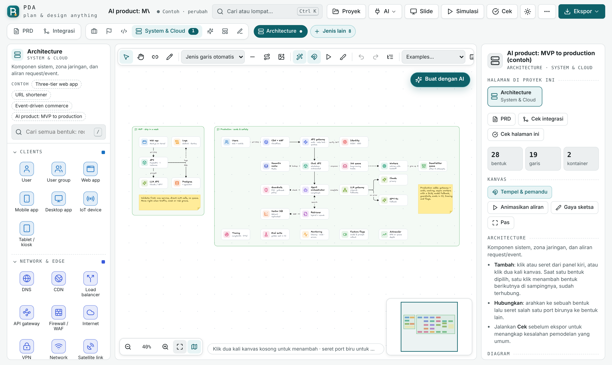

<div align="center">

[English](README.md) · **Bahasa Indonesia**

# PDA: Plan & Design Anything

### Rencanakan visimu. Rancang sistemmu.

**Dari strategi bisnis dan pemodelan proses sampai arsitektur software, AI, dan otomasi. Satu studio, satu file, tanpa instalasi.**

[](https://github.com/Sakazu01/pda/actions/workflows/ci.yml)
[](LICENSE)

[**Buka aplikasi**](https://sakazu01.github.io/pda/) · [Mulai cepat](#mulai-cepat) · [Yang bisa dirancang](#yang-bisa-dirancang) · [Keamanan](#keamanan--datamu) · [Dokumentasi](#dokumentasi)



</div>

---

PDA adalah studio diagram untuk orang yang perlu **memikirkan sistem sampai tuntas sebelum membangunnya**. Kamu cukup menjelaskannya sekali, lewat PRD atau satu kalimat untuk AI. PDA lalu menyusun diagram yang tepat: use case, BPMN, ERD, sequence, arsitektur, deployment, wireframe, sampai slide. Semuanya ada dalam satu proyek dan saling konsisten.

PDA dikirim sebagai **satu file HTML mandiri**. File itu bisa dibuka langsung dari disk, di-host di GitHub Pages, atau ditaruh di server statis mana pun. Tidak ada backend, tidak perlu akun, dan tidak ada telemetri.

## Sorotan

- **48 jenis diagram + 38 framework** dalam 7 ruang kerja: Bisnis & SI, Manajemen & Riset, Software Eng., System & Cloud, AI & Automation, Produk & UX, Whiteboard.
- **Panduan "Mau merancang apa?"**: pilih tujuanmu, lalu PDA menyarankan diagram apa yang perlu dibuat, urutannya, dan alasannya.
- **PRD → semua kanvas**: tulis `## Aktor`, `## Alur`, `## Entitas Data`, `## Arsitektur`, lalu PDA membangun setiap halaman dan mengecek konsistensinya.
- **Buat dengan AI di setiap kanvas**: jenis diagram bisa dipilih sendiri atau ditentukan AI. Hasilnya diletakkan *di sebelah* hasil sebelumnya, dan Ctrl+Z membatalkannya. Pakai Claude bawaan atau model milikmu (OpenAI, Anthropic, Gemini, Groq, OpenRouter, DeepSeek, Ollama, LM Studio). Status **Terhubung / Tidak terhubung** langsung muncul begitu kunci API dimasukkan.
- **Garis yang rapi**: router ortogonal A*. Pada graf padat (200 bentuk, 300 garis) tidak ada satu pun garis yang menembus bentuk. Label duduk di atas garis seperti di Excalidraw dan bisa digeser. Segmen bisa diseret dan tekukan bisa ditambah.
- **150+ logo tech stack asli** dari tech-stack-icons (MIT). Produk yang belum punya logo diberi lencana monogram.
- **Folder proyek**: proyek disimpan sebagai file `.pda.json` di folder pilihanmu. Daftarnya bisa di-scroll dan langsung dibuka.

## Mulai cepat

1. **Langsung buka**: unduh [`dist/index.html`](dist/index.html), lalu klik dua kali.
2. **Versi online**: https://sakazu01.github.io/pda/
3. **Kembangkan**:

```bash
git clone https://github.com/Sakazu01/pda.git
cd pda
npm install          # hanya alat tes: Playwright, axe-core
npm run build        # src/ → dist/index.html
npm run test:quick   # tes cepat ~1 menit
npm test             # semua tes browser (400+ cek)
```

## Yang bisa dirancang

| Ruang kerja | Diagram |
|---|---|
| **Bisnis & SI** | BPMN, Value Chain, Five Forces, Work System, Struktur Organisasi, DIKW, SWOT, BMC, PESTEL, VPC, McFarlan, Lean Canvas, BCG, Ansoff, SIPOC, 7S, BSC… |
| **Manajemen & Riset** | SMART, OKR, Eisenhower, RACI, Matriks risiko, Gantt, Kanban, Retro, PDCA, DMAIC, Fishbone, 5 Whys, PRISMA… |
| **Software Eng.** | Use Case, Activity, Sequence, Class, State Machine, DFD, ERD (crow's foot & Chen), Component, Deployment, Kontrak API, Event Storming |
| **System & Cloud** | Architecture, C4, Kubernetes, Topologi jaringan, Pola terdistribusi, System design, Threat model (STRIDE), CI/CD |
| **AI & Automation** | n8n, LangGraph agent, RAG pipeline, Multi-agent, ML pipeline |
| **Produk & UX** | User flow, Wireframe, Customer journey, Sitemap, Persona, Empathy map, Kano, MoSCoW, RICE, Roadmap, Service blueprint |
| **Whiteboard** | Papan bebas, Mind map, Pitch deck |

## Keamanan & datamu

- **CSP ketat**: satu-satunya script inline dikunci dengan hash SHA-256, sehingga markup sisipan tidak bisa menjalankan script.
- **Setiap impor disanitasi**: ID, warna, URL, dan ikon SVG divalidasi. Script, event handler, dan tautan luar dibuang. Ukuran file maksimal 25 MB.
- **Script eksternal memakai SRI**: pustaka PowerPoint dimuat dengan hash `sha384`.
- **Kunci API tetap milikmu**: hanya disimpan selama sesi (kecuali kamu memilih *ingat*) dan hanya dikirim lewat HTTPS ke endpoint yang kamu atur.
- **File di disk-mu sendiri**: nama file selalu dibuat oleh PDA, dan tidak ada data yang keluar dari komputermu.

Laporkan celah keamanan lewat [SECURITY.md](SECURITY.md).

## Dokumentasi

Lihat folder [docs/](docs/). Mulailah dari [getting-started.md](docs/getting-started.md) dan [architecture.md](docs/architecture.md).

## Lisensi

[MIT](LICENSE) © Ariel Cornelius Sitorus. Aset pihak ketiga tercantum di [THIRD_PARTY_NOTICES.md](THIRD_PARTY_NOTICES.md).
