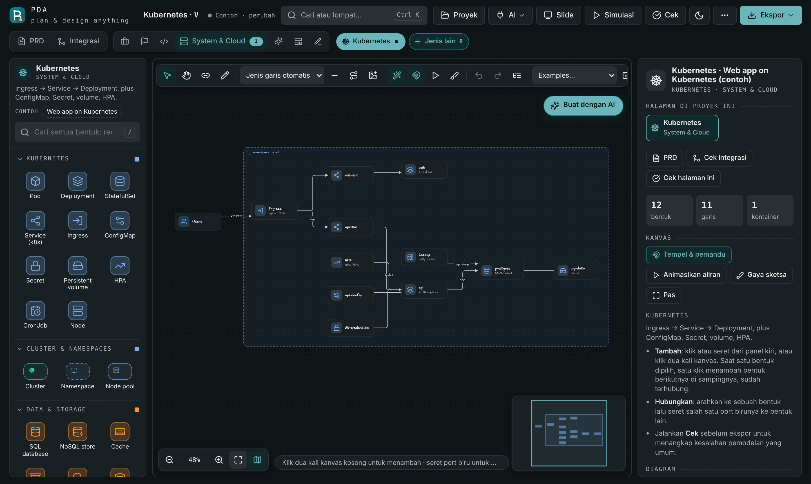
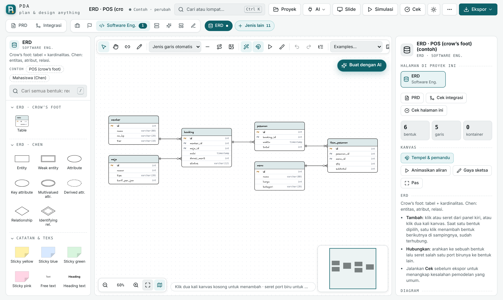
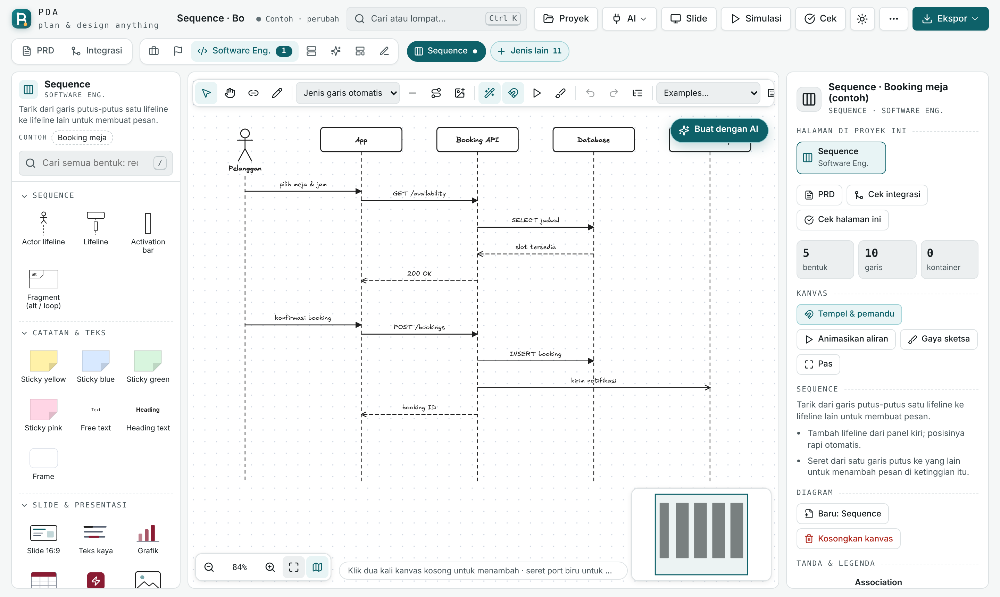
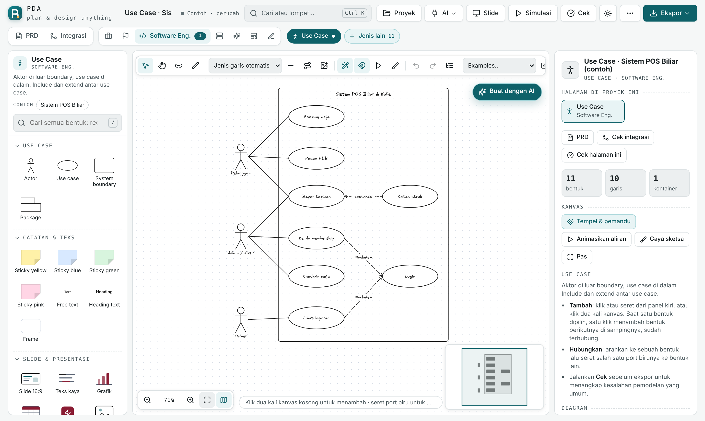
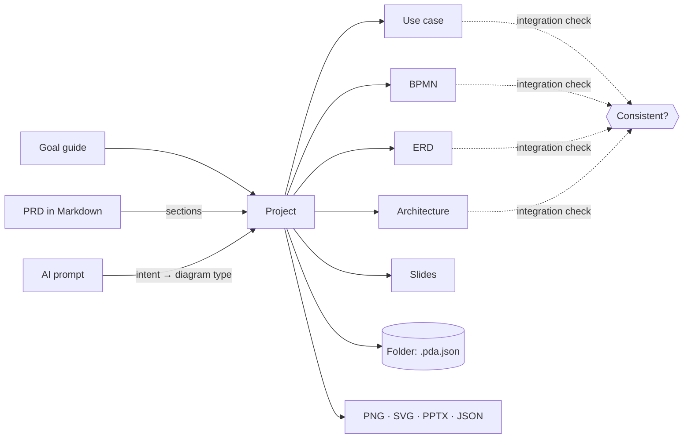

<div align="center">

**English** · [Bahasa Indonesia](README.id.md)

# PDA: Plan & Design Anything

### Plan your vision. Design your system.

**From business strategy and process modeling to software architecture, AI, and automation. One studio, one file, no install.**

[](https://github.com/Sakazu01/pda/actions/workflows/ci.yml)
[](https://github.com/Sakazu01/pda/releases)
[](LICENSE)


[](CONTRIBUTING.md)

[**Open the app**](https://sakazu01.github.io/pda/) · [Quick start](#quick-start) · [What you can design](#what-you-can-design) · [How it works](#how-it-works) · [Security](#security--your-data) · [Docs](#documentation) · [FAQ](#faq)

```bash
git clone https://github.com/Sakazu01/pda.git && open pda/dist/index.html
```


</div>

---

PDA is a diagram studio for people who have to **think a system through before they build it**. You describe the thing once, as a PRD or a sentence for the AI, and PDA turns it into the right set of diagrams: use cases, BPMN, ERD, sequence, architecture, deployment, wireframes and slides. All of them live in one project and stay consistent with each other.

It ships as **one self-contained HTML file**. Open it from your disk, host it on GitHub Pages, or drop it on any static server. There is no backend, no account and no telemetry.

## Highlights

| | |
|---|---|
| **48 diagram types + 38 frameworks, 7 workspaces** | Business & IS, management & research, software engineering, system & cloud, AI & automation, product & UX, whiteboard |
| **"What do you want to design?" guide** | Pick a goal (an app, a business process, cloud infra, an AI agent) and PDA tells you which diagrams to make, in which order, and why |
| **PRD → every canvas** | Write `## Aktor`, `## Alur`, `## Entitas Data`, `## Arsitektur`… and PDA builds and cross-checks every page from it |
| **AI generate, anywhere** | Every canvas has an AI button. It picks the right diagram type for you (or you choose), places the result *beside* earlier ones, and Ctrl+Z undoes it. Use the built-in Claude or bring your own model (OpenAI, Anthropic, Gemini, Groq, OpenRouter, DeepSeek, Ollama, LM Studio) |
| **Lines that behave** | Orthogonal router with A* search. In dense graphs (200 shapes, 300 lines) **no line passes through a shape**. Labels sit *on* the line like Excalidraw and slide along it. Drag segments, add bends, and switch between straight, elbow and curve |
| **150+ real tech logos** | From [tech-stack-icons](https://www.tech-stack-icons.com/) (MIT), with light/dark variants. Products without a logo in the pack get a clean monogram badge |
| **Present it** | Pitch-deck slides with charts and tables, PowerPoint export, step-through simulation of flows |
| **Yours, on your disk** | Projects can live in a folder you pick as plain `.pda.json` files. They also export to PNG, SVG and JSON |

<p align="center">
  
  
</p>

## Quick start

### 1 · Just open it

Download [`dist/index.html`](dist/index.html) (or the release asset) and double-click it. That's it. Chrome, Edge, Firefox and Safari all work.

### 2 · Or use the hosted copy

**https://sakazu01.github.io/pda/**: the same file, deployed from `main` by GitHub Actions.

### 3 · Hack on it

```bash
git clone https://github.com/Sakazu01/pda.git
cd pda
npm install          # dev tools only: Playwright, axe-core
npm run build        # src/ → dist/index.html
npm run test:quick   # ~1 min smoke suite
npm test             # full browser suite (400+ checks)
```

The app needs **no dependencies at runtime**. `npm install` exists only for the test tools.

## What you can design

| Workspace | Diagrams |
|---|---|
| **Business & IS** | BPMN, Value Chain, Five Forces, Work System, Org chart, DIKW, Business–IS–IT, SWOT, Business Model Canvas, PESTEL, Value Proposition Canvas, McFarlan, Lean Canvas, BCG, Ansoff, SIPOC, 7S, Balanced Scorecard… |
| **Management & Research** | SMART, OKR, Eisenhower, RACI, Risk matrix, Gantt, Kanban, Retro, PDCA, DMAIC, Fishbone, 5 Whys, Decision matrix, PRISMA… |
| **Software Engineering** | Use Case, Activity, Sequence, Class, State Machine, DFD, ERD (crow's foot & Chen), Component, Deployment, API contract, Event Storming |
| **System & Cloud** | Architecture, C4, Kubernetes, Network topology, Distributed patterns, System design, Threat model (STRIDE), CI/CD |
| **AI & Automation** | n8n workflow, LangGraph agent, RAG pipeline, Multi-agent, ML pipeline |
| **Product & UX** | User flow, Wireframe, Customer journey, Sitemap, Persona, Empathy map, Kano, MoSCoW, RICE, Roadmap, Service blueprint, Story map |
| **Whiteboard** | Free board, Mind map, Pitch deck |

<p align="center">
  
  
</p>

## How it works



1. **One project, many pages.** Each diagram type is a page. A shared PRD and glossary keep names consistent, and *Cek integrasi* reports actors, entities or services that one page uses but another forgets.
2. **AI that knows what to draw.** A keyword intent map, with an LLM classifier as fallback, picks the diagram type. Type-specific prompts return structured JSON, never raw markup. The result is validated, sanitized and laid out before it touches the canvas.
3. **A real line router.** It builds a sparse visibility grid from shape borders and runs A* per line, with bend and shared-channel penalties. Lines that find no free path retry with soft walls. Parallel lines are spread apart unless that would push one into a shape. Big graphs finish in a background pass, so the UI never blocks. Details in [docs/line-routing.md](docs/line-routing.md).

## Security & your data

PDA is built to be safe to open files from strangers in.

- **Strict Content-Security-Policy.** The single inline script is pinned by its SHA-256 hash, so injected markup cannot run script. `object-src`, `base-uri` and `form-action` are all `'none'`.
- **Every import is sanitized.** IDs, colors, URLs and SVG icons are validated. Script, `foreignObject`, event handlers and remote links are stripped. A file is capped at 25 MB.
- **The only external script carries Subresource Integrity.** PowerPoint export loads `pptxgenjs@3.12.0` with a `sha384` hash.
- **API keys stay with you.** They are kept for the session only, unless you tick *remember*. They are sent only to the endpoint you configured, and only over HTTPS (plain HTTP is allowed for `localhost` models).
- **Your files, your disk.** With a project folder, files are written only under names PDA builds itself (`title--id.pda.json`). Nothing leaves your machine.

See [SECURITY.md](SECURITY.md) to report a vulnerability, and [docs/security.md](docs/security.md) for the full model.

## Documentation

| Doc | What's inside |
|---|---|
| [docs/getting-started.md](docs/getting-started.md) | First project, the goal guide, PRD → canvases, exporting |
| [docs/ai.md](docs/ai.md) | AI generate, intent detection, bring-your-own-model setup |
| [docs/line-routing.md](docs/line-routing.md) | The router, labels, waypoints and keyboard shortcuts for lines |
| [docs/project-folder.md](docs/project-folder.md) | Saving projects to a folder, the `.pda.json` format |
| [docs/architecture.md](docs/architecture.md) | Source layout, module order, the override pattern, build |
| [docs/security.md](docs/security.md) | Threat model, CSP, sanitization, key handling |
| [docs/testing.md](docs/testing.md) | Test suites and how to add one |
| [AGENTS.md](AGENTS.md) | Rules for humans and coding agents working on this repo |

## FAQ

<details><summary><b>Is it really just one file?</b></summary>

Yes. `dist/index.html` holds the app, the icons (Lucide), the tech logos and the Excalifont handwriting font. Google Fonts (Geist) loads when you are online and falls back to system fonts when you are not.
</details>

<details><summary><b>Do I need an API key for AI?</b></summary>

Not when PDA runs inside Claude, which provides the built-in model. Standalone, pick a provider under **AI** and paste your key, or run a local model with Ollama or LM Studio for free.
</details>

<details><summary><b>Where is my work saved?</b></summary>

It saves to browser storage automatically. In Chrome or Edge you can also pick a **project folder**, and every project is then written there as a `.pda.json` file you can back up, sync or put in git.
</details>

<details><summary><b>Why no React, no bundler?</b></summary>

The app must open from a USB stick with no network and no install. Plain browser JavaScript plus a small Node build script gives that. See [docs/architecture.md](docs/architecture.md).
</details>

<details><summary><b>Can I use it for coursework or at work?</b></summary>

Yes. It is MIT-licensed. Diagrams you make are yours.
</details>

## Contributing

Bug reports, diagram types and translations are welcome. Read [CONTRIBUTING.md](CONTRIBUTING.md) and [AGENTS.md](AGENTS.md), and run `npm run test:quick` before opening a pull request.

## License

[MIT](LICENSE) © Ariel Cornelius Sitorus. Bundled third-party assets are listed in [THIRD_PARTY_NOTICES.md](THIRD_PARTY_NOTICES.md).
